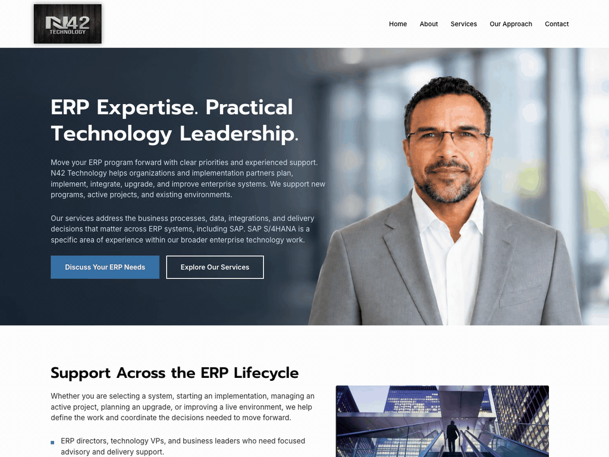

# N42 Technology: ERP Consulting Website Update

> Quality over speed, and nothing goes live until the client approves.

N42 Technology is an ERP and AI advisory firm. The founder wrote new copy for his WordPress site and wanted a cleaner, more professional look for ERP leaders and implementation partners.

## What I did

1. Updated 5 pages (Home, About, Services, Our Approach, Contact) to match his content document exactly, with his images and alt text
2. Removed outdated testimonials, counters, unsupported claims and duplicate sections
3. Renamed "Why Choose Us" to "Our Approach" and kept its URL, so existing links still work
4. Rebuilt the header, menu and footer site wide, and made the logo bigger without losing sharpness
5. Rebuilt the contact form and tested real delivery to the business inbox, plus the success and error messages

To keep the live site safe, I backed up the original pages, built everything as unpublished drafts, reviewed it all on computer and phone, and published only after his sign off, with the same URLs.

**Stack:** WordPress, Elementor Pro, Astra.

Demo video: [n42-technology-erp-consulting-website-update.mp4](../videos/n42-technology-erp-consulting-website-update.mp4)

[Back to all projects](../README.md)
