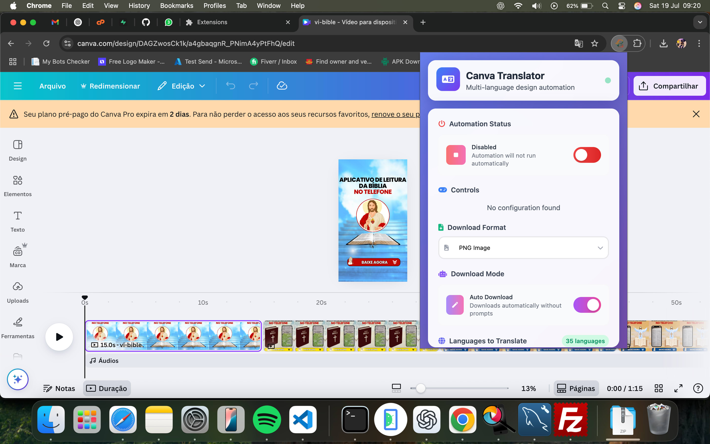

# Canva Multi-Language Design Automation Extension

> 3+ hours per design down to about 15 minutes.

A client was recreating the same Canva designs in 35+ languages by hand, because Canva has no bulk translation.

I built a Chrome extension that drives the translation workflow through Canva's own interface:

1. Smart element detection with timeout handling
2. Configurable language sets and download formats
3. Auto or manual download modes
4. Real-time progress timers in a clean glassmorphism UI

Now all 35 language variants run automatically while the team works on something else.

**Stack:** JavaScript, Chrome Extension (Manifest V3), CSS.

[Back to all projects](../README.md)
