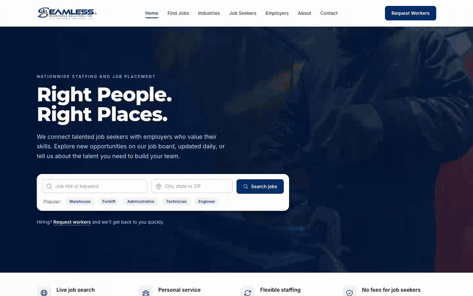

# Staffing Agency Website & Live Job Board Web App

> A job board with 13,000+ live jobs, ready in 2 weeks.

A US staffing agency needed a professional website and a live job board before their Google and Facebook ad campaign, on a tight budget.

## What I built

1. A fast, mobile friendly site with pages for job seekers, employers, industries, about and contact
2. A job board that pulls live jobs from Adzuna, Jooble, USAJOBS, The Muse, PostJobFree and company career sites, with search by keyword, location, distance, industry, job type, date and remote
3. Apply Now forms with resume upload, plus talent pool, staffing request and contact forms, each emailed to the right team inbox
4. A private admin dashboard with email code sign in, job counts, daily history and form submissions
5. Google Analytics and Google Ads conversion tracking, a cookie consent banner, live chat and SEO setup

## The hard parts

1. Job feeds are messy, so I filtered out spam, gig ads, non US and duplicate listings, and hid employer names so applicants apply through the agency
2. Some free APIs allow only 500 requests, so caching and request budgets keep the site from ever showing errors
3. Spam protection, automated browser tests and auto deployment to a VPS keep it reliable

Delivered on time. The client went live with a full job board and is now running ads to grow their audience. The video walks through the site.

Demo video: [staffing-agency-website-live-job-board-web-app.mp4](../videos/staffing-agency-website-live-job-board-web-app.mp4)

[Back to all projects](../README.md)
