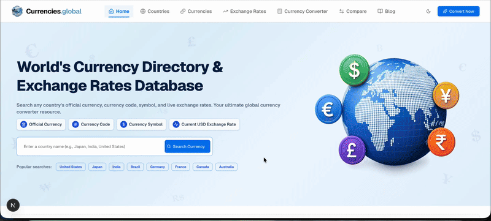

# SEO Currency Directory & Custom Admin Dashboard

> Leaving a paid CMS without losing your SEO.

A currency exchange directory wanted to manage everything inside its own Next.js site instead of third-party CMS platforms. I built a native admin panel and the public pages around it.

## What shipped

1. Secure React/Next.js admin dashboard for posts, categories, and exchange listings
2. "Near Me" directory pages with local SEO schema for 100+ US cities
3. Homepage grid of 18 currency pairs with sparklines
4. Self-contained SQLite database with zero monthly fees
5. SEO-friendly routes with legacy redirects, plus patched server dependency vulnerabilities to meet the host's security rules

**Stack:** Next.js, React, SQLite, local SEO schema.

[Back to all projects](../README.md)
