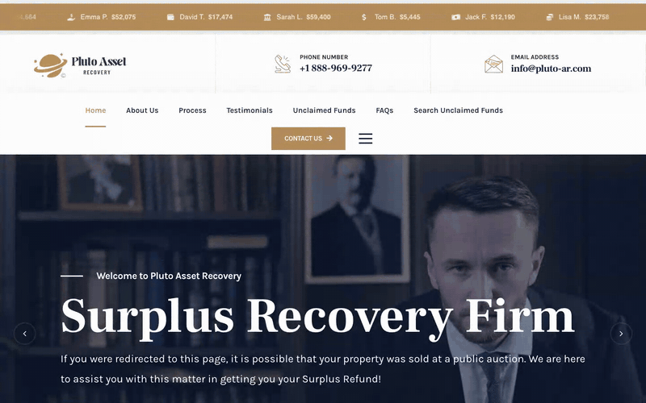

# WordPress Surplus Funds Site & Claim Search Portal

> Find your money and file a claim in under a minute.

Pluto Asset Recovery helps US property owners recover surplus funds after foreclosure and tax deed auctions. I built custom features on their WordPress site.

## What I built

1. An Unclaimed Funds search portal: search by first name, last name or company and see the property address, county, auction date and surplus amount
2. Whole word matching, 10 results per page, and a live CSV leads database that shows new leads as soon as the file is replaced
3. A step by step claim page that carries over the selected record
4. Claims sent through Contact Form 7's REST API and delivered to the team by email with WP Mail SMTP
5. Google Ads ready links that run the search for a name or company and take the visitor straight to their claim
6. A contact page with SMS marketing and support opt ins, a Terms and Conditions page, and Google tag setup

**Stack:** WordPress, Contact Form 7, WP Mail SMTP, JavaScript, HTML, CSS, Hostinger.

Owners find their money fast, and the firm receives qualified leads by email. The video walks through the site.

Demo video: [wordpress-surplus-funds-site-claim-search-portal.mp4](../videos/wordpress-surplus-funds-site-claim-search-portal.mp4)

[Back to all projects](../README.md)
