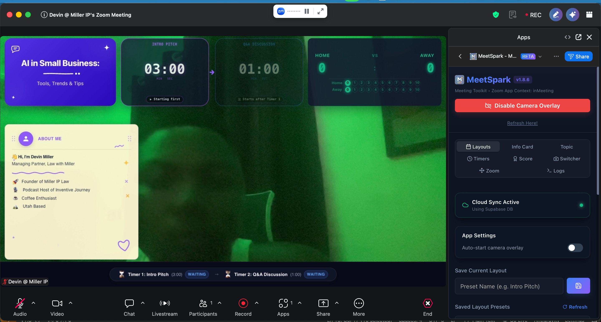

# MeetSpark: Zoom App Overlays & Camera Switcher

> Zoom has no native transparent overlays on camera video. So we built one.

MeetSpark is a Zoom Marketplace app that places branded widgets on the user's live camera feed: topic cards, intro cards, countdown timers, and scoreboards.

## How it works

1. Layouts render on an invisible layer above the camera feed
2. A host control panel toggles and edits widgets live
3. Automatic multi-camera switching, plus smooth and preset digital zoom
4. Real-time sync between host and participants
5. No more white flash on camera switches, thanks to an instantly transparent background

**Stack:** Zoom Apps SDK, JavaScript, TypeScript.

[Back to all projects](../README.md)
