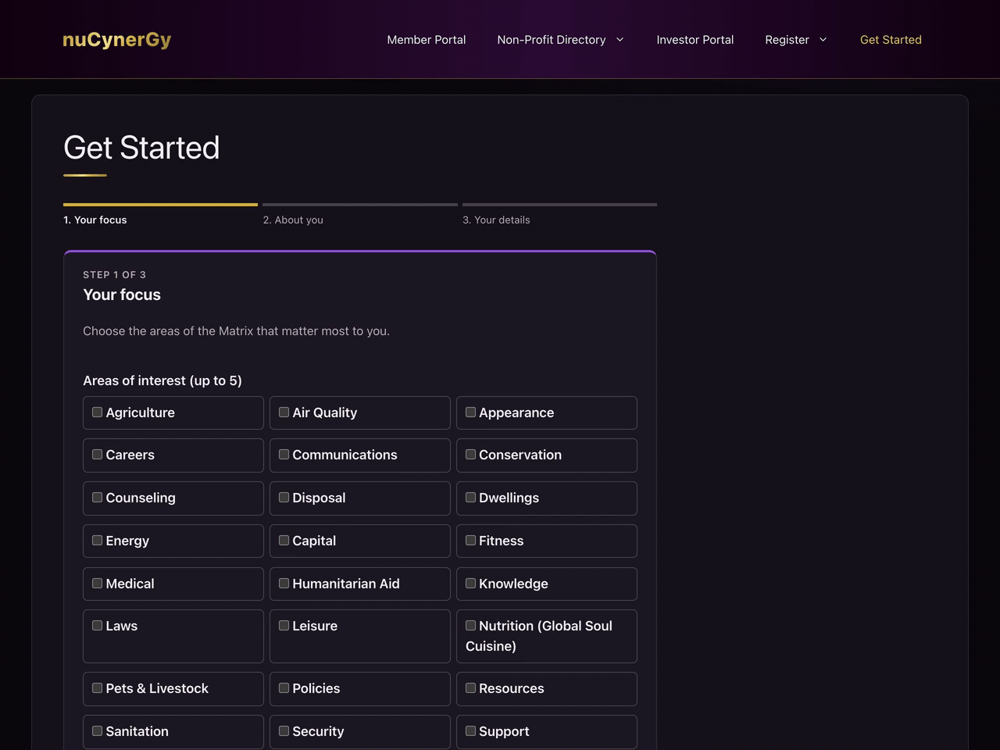

# Membership & Investor Portal Web App (WordPress)

> Memberships, donations and a private investor vault, on existing WordPress hosting.

A community impact startup connects members, non-profits and investors across 27 life categories they call the Matrix. They needed an automated MVP that routes every new lead to the right membership tier, bills members, supports non-profits with micro donations, and gives approved investors a private vault.

## What I built

1. A 3 step Matrix intake form with rule based routing across 27 categories and a 30 to 90 day email nurture with SendGrid
2. Tiered memberships with Stripe billing, auto renew, referral credits and donation round ups
3. A member portal, non-profit directory and sponsored events calendar
4. An investor portal with an online NDA, letter of intent and a role locked vault for documents and videos
5. Admin activity log, form validation, rate limiting and security hardening

## The hard parts

1. The free membership plugin adds a 2% Stripe fee that isn't listed on its plugin page. I found it in the plugin code, explained the options, and set up billing the way the client chose
2. Investor files had to stay hidden from members, so files are served through access checked links and every path is tested for each role
3. The site had to stay private until launch, so I added a Coming Soon gate and ran automated end to end browser tests on the live server

**Stack:** PHP 8, WordPress, Stripe, SendGrid, Playwright.

The video gives a quick tour of the portal.

Demo video: [membership-investor-portal-web-app-wordpress.mp4](../videos/membership-investor-portal-web-app-wordpress.mp4)

[Back to all projects](../README.md)
