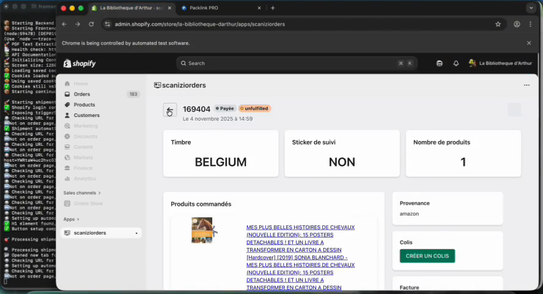

# Print Preview PDF Modifier

> One button instead of a daily copy-paste routine.

A Shopify retailer was fixing and printing shipping labels by hand, order by order, between Shopify and Packlink.

I built an automation that:

1. Watches for label downloads and rewrites the PDFs in real time
2. Drives the browser to sync tracking data back to Shopify
3. Keeps both sessions alive with a persistent Playwright browser context
4. Opens Packlink shipments directly through deep links
5. Makes print dialogs behave the same on macOS and Windows

The whole workflow now runs from one button. The video shows it in action.

**Stack:** Playwright, JavaScript, PDF processing, Shopify.

Demo video: [print-preview-pdf-modifier.mp4](../videos/print-preview-pdf-modifier.mp4)

[Back to all projects](../README.md)
