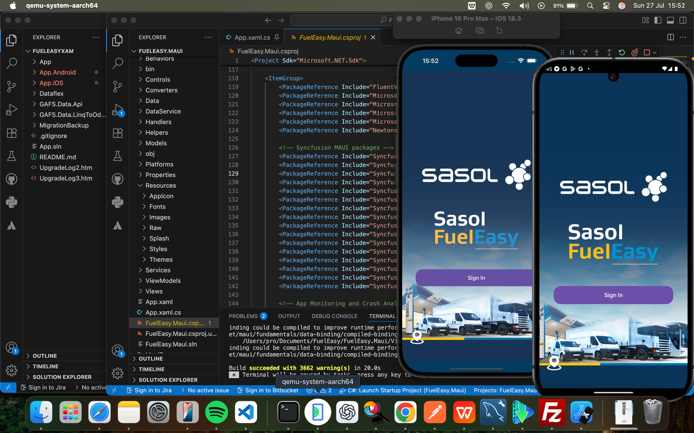

# FuelEasy Mobile: .NET MAUI Fuel Station Locator

> Finding the nearest fuel station should take seconds, on any phone.

FuelEasy (FuelFinder Pro) is a cross-platform .NET MAUI 9 app for iOS and Android that helps drivers find nearby stations.

## Features

1. Real-time GPS with distance and bearing indicators
2. Interactive maps with custom markers
3. Geocoded search
4. Secure sign-in with OAuth2/OIDC
5. Custom native handlers for platform-specific file handling and performance

**Stack:** C#, .NET MAUI 9, Syncfusion UI controls, MVVM.

[Back to all projects](../README.md)
