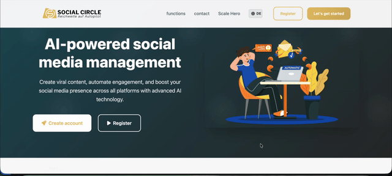

# Social Circle SaaS App Landing & Automation Portal

> Connecting a web dashboard to real phones, in real time.

For the Social Circle automation platform, I built the core SaaS portal and landing interface.

## What shipped

1. Secure authentication and registration
2. Subscription and billing flows
3. Real-time ASP.NET Core API endpoints that queue tasks and register device sessions
4. Automation logs tracked securely in a Supabase backend

The hard part was coordinating the web panel with physical mobile devices. The queue and session endpoints solved it.

**Stack:** C#, ASP.NET Core, Supabase, REST APIs.

[Back to all projects](../README.md)
