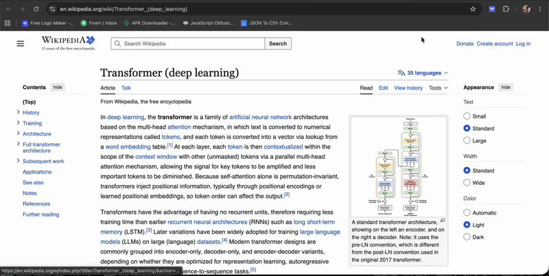

# Markvein: Offline Web Highlighter & Dashboard

> Research notes that stay on your own machine.

Markvein is an offline Manifest V3 Chrome extension for highlighting, tagging, searching, and exporting web snippets.

## How it works

1. Select text and use a custom right-click menu
2. Assign up to 3 tags in an inline modal
3. Highlights re-render when you revisit the page, stored in chrome.storage.local
4. A popup dashboard groups highlights by domain with live search by text or tag
5. One-click delete and JSON export

**Stack:** JavaScript, Tailwind CSS, service workers, content scripts.

Source code: [Web-Highlights-Extension](https://github.com/developer-vic/Web-Highlights-Extension)

[Back to all projects](../README.md)
