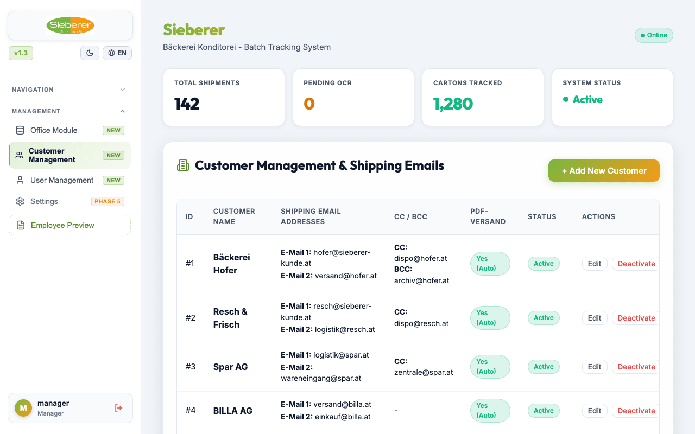

# DAPS: Bakery Logistics & Batch Tracking Web App

> Paper tracking does not survive a busy bakery. Wi-Fi dead zones make it harder.

A commercial bakery needed to replace paper logs for batches, supplier deliveries, and customer shipments. I built DAPS, an offline-first mobile web app.

## What staff can do

1. Search customers and scan barcodes and shipping labels with the phone camera
2. Photograph items and delivery notes without signal
3. Sync data and photos automatically on reconnect
4. Log in by role: suppliers see delivery screens, managers get full logs
5. Generate PDF invoices and email reports

Packaged in containers for self-hosting.

**Stack:** Progressive Web App, JavaScript, Docker, barcode scanning.

[Back to all projects](../README.md)
