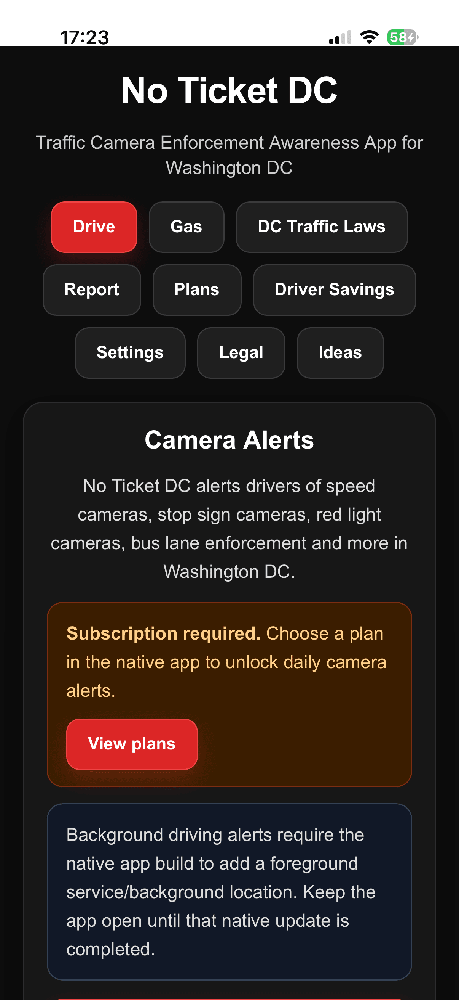

# NoTicket: Traffic Camera Alert & Dispute App

> 14,000+ traffic camera locations across all 50 US states, with voice alerts even when the screen is locked.

NoTicket helps drivers avoid citations and appeal tickets. It is a responsive React web app running inside native iOS and Android WebView shells.

## What I built

1. Background GPS voice alerts for speed, red-light, and school zone cameras
2. A Leaflet map to search camera locations
3. Apple StoreKit and Google Play Billing subscriptions
4. Android foreground services and iOS WKWebView bridges so alerts keep running
5. Server-side receipt verification with Netlify Functions

**Stack:** React, iOS, Android, Leaflet, Netlify Functions.

[Back to all projects](../README.md)
