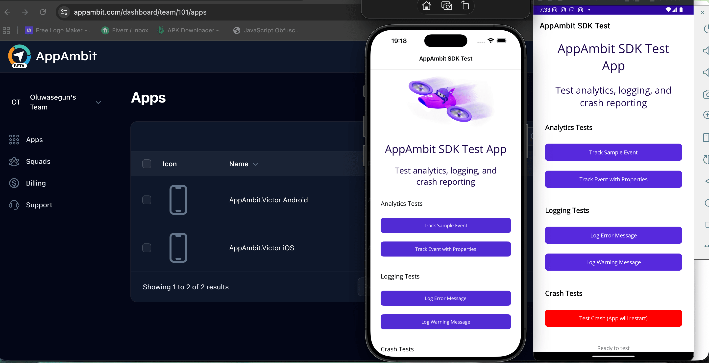

# AppAmbit SDK Integration

> Testing an SDK properly before customers do.

AppAmbit, a startup building an alternative to App Center, asked me to integrate their .NET MAUI SDK into a cross-platform Android and iOS test app and validate it end to end.

## What I did

1. Built a test harness for analytics, logging, and crash flows
2. Set platform-specific app keys and produced release builds
3. Confirmed events, logs, and crash reports in their dashboard
4. Reported onboarding, email, and login issues, plus a missing upload API endpoint
5. Delivered source code, a README, and a step-by-step handoff guide

**Stack:** C#, .NET MAUI, Android, iOS.

[Back to all projects](../README.md)
