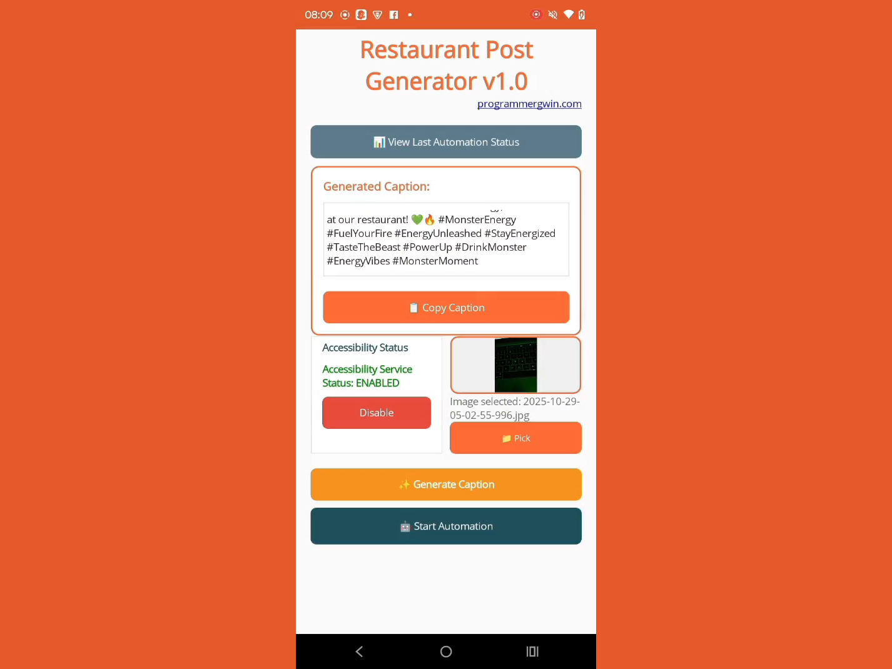

# Restaurant Post Generator Automation

> Posting to 4 platforms in one run.

A small restaurant group wanted to publish photos or videos with consistent captions to its own Facebook, Instagram, TikTok, and Google Maps business profiles without doing each one by hand.

I built a cross-platform app with:

1. An Android accessibility layer with ID, text, and position fallbacks
2. Localized strings so the flow survives UI changes
3. Google Maps posting through the native app's Business tab
4. Helpers that detect and dismiss confirmation dialogs automatically

The video shows a full posting run.

**Stack:** Android, Java, accessibility services, automation.

Demo video: [restaurant-post-generator-automation.mp4](../videos/restaurant-post-generator-automation.mp4)

[Back to all projects](../README.md)
