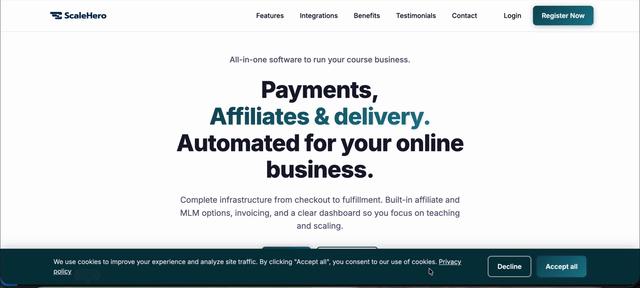

# ScaleHero Standalone Course Platform & Affiliate

> Selling courses with a built-in affiliate channel.

I designed and developed ScaleHero, an e-learning and course-hosting application with an integrated affiliate and MLM marketing channel.

## What I built

1. A modern seller and buyer workflow with a CopeCart-inspired UI
2. Database models for course hierarchy: topics, sections, and items
3. Member dashboards for course downloads, invoices, and affiliate payouts
4. Multi-tier affiliate options

**Stack:** web application, database design, dashboards.

[Back to all projects](../README.md)
