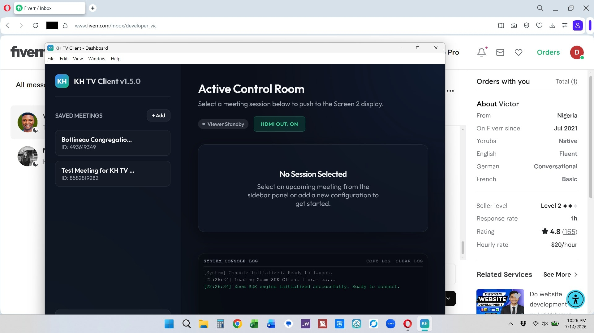

# Custom Zoom Client & Dual-Screen Admin Dashboard

> A clean Zoom feed on the big screen, full control on the laptop.

I built a custom Zoom program for broadcasting: an admin control room runs on the main display while a silent, clean meeting feed plays on a second TV or projector.

## Details

1. All Zoom toolbars, headers, shields, and name overlays hidden for a clean feed
2. 1 or 2 spotlighted speakers centered, while larger grids lay out normally
3. The app fully muted in the system mixer so no meeting audio leaks
4. A control room that resizes for small laptop screens and remembers its window size and position

**Stack:** Zoom SDK, JavaScript, CSS, desktop app.

[Back to all projects](../README.md)
