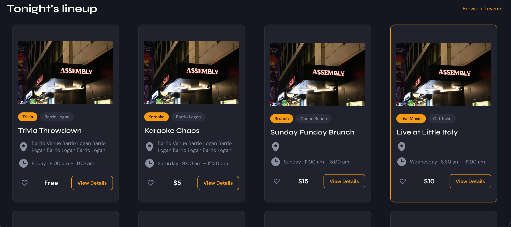

# BarOwl: Nightlife & Event Discovery Web App

> Stopping screenshot sharing with a live ticking clock.

BarOwl is a nightlife and event discovery web app built on Bubble. It connects users with bar events, deals, and member perks, with separate experiences for users and bar managers.

## What I built

1. Simpler event creation with a unified date and time picker and day-of-week options
2. A digital member pass with name, date of birth, and a live ticking clock, so screenshots can't be reused
3. A self-serve partner opt-in and opt-out flow for managers
4. Fully mobile responsive pages with role-based access control

**Stack:** Bubble.io, no-code development.

[Back to all projects](../README.md)
