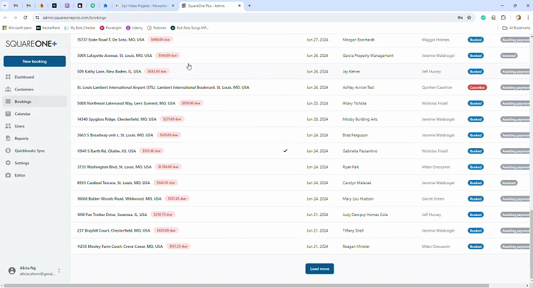

# Monday to Square One Chrome Extension

> Small extension, many saved clicks.

A team was copying Dropbox links from Monday.com items into the matching items on their Square One platform by hand.

I built a Chrome extension that:

1. Copies the Dropbox link from the Monday item and pastes it into the matching Square One item
2. Adds a "Check URL" button to verify the current Dropbox link
3. Opens a small window showing the Dropbox page inside Square One whenever a booking is opened

The video walks through the flow.

**Stack:** JavaScript, Chrome Extension, API integration.

Demo video: [monday-to-square-one-chrome-extension.mp4](../videos/monday-to-square-one-chrome-extension.mp4)

[Back to all projects](../README.md)
