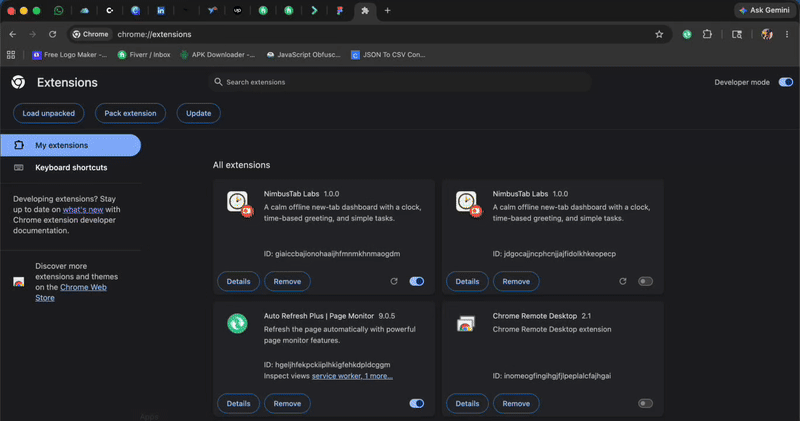

# NimbusTab Labs: Minimalist New-Tab Dashboard

> A new tab page that works offline.

NimbusTab Labs is a minimalist Manifest V3 Chrome extension that turns the new tab into a personal dashboard:

1. A large real-time clock and a time-based greeting
2. A to-do list with up to 20 tasks saved in localStorage
3. A flat color theme that shifts with the time of day
4. JetBrains Mono and custom SVG icons loaded locally

Pure HTML, CSS, and JavaScript. No frameworks, no CDN libraries, fully offline.

Source code: [Chrome-New-Tab-Dashboard](https://github.com/developer-vic/Chrome-New-Tab-Dashboard)

[Back to all projects](../README.md)
