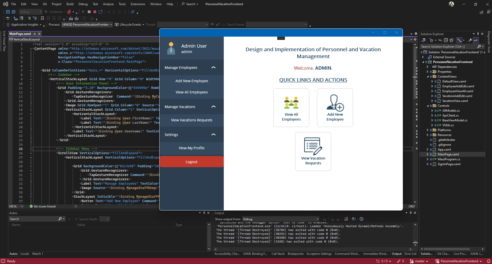

# Personnel and Vacation Management

> Leave requests without the email chains.

I built personnel and vacation management software in C#:

1. A .NET MAUI frontend
2. An ASP.NET Core REST API
3. Entity Framework for all database access
4. Role-based login

Admins create and manage employees, issue login credentials, and approve or reject leave requests. Employees see their details and remaining vacation days, submit requests, and track approval status with dates.

**Stack:** C#, .NET MAUI, ASP.NET Core, Entity Framework.

[Back to all projects](../README.md)
