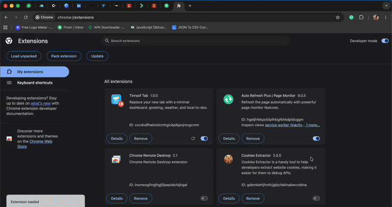

# Weather & To-Dos Minimal Chrome Dashboard

> Weather and tasks on every new tab.

I built a Manifest V3 Chrome extension that replaces the new tab page with a productivity hub:

1. Live local weather using browser geolocation and the free Open-Meteo API
2. A task manager stored with chrome.storage.local
3. A background gradient that shifts with the local time of day
4. A centered card layout

Built with vanilla HTML5, modern CSS, and asynchronous JavaScript.

Source code: [Weather-and-TODO-Extension](https://github.com/developer-vic/Weather-and-TODO-Extension)

[Back to all projects](../README.md)
