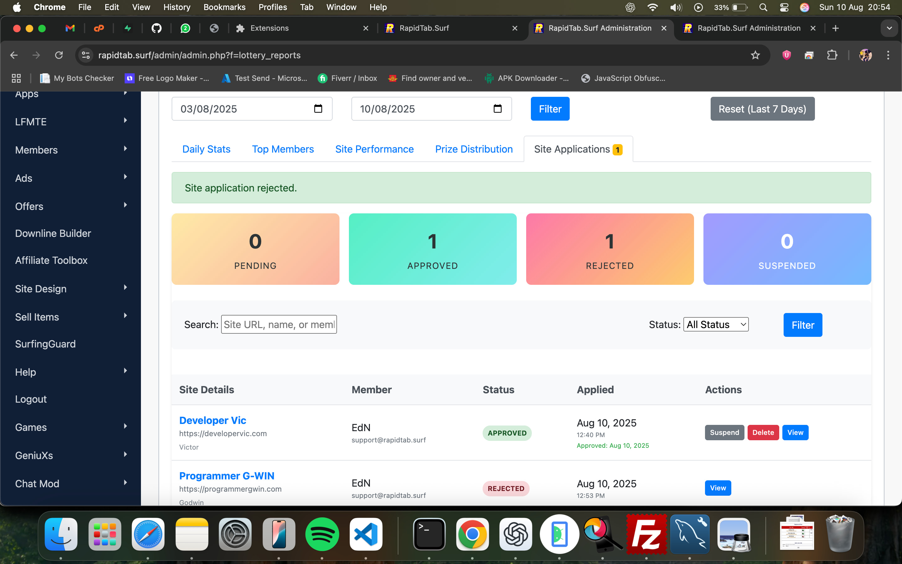

# RapidTab Surf Premium Site Application System

> Quality control for a premium program.

RapidTab Surf is a traffic exchange platform where members earn credits by surfing sites and promote their own. I built its Premium Site Application System.

## How it works

1. Site owners apply for premium status through an integrated form
2. Administrators review applications in the lottery admin panel
3. Admins approve, reject, or suspend sites with notes
4. Approved sites join the premium lottery rotation automatically

**Stack:** PHP, web application, database design, admin dashboard.

[Back to all projects](../README.md)
