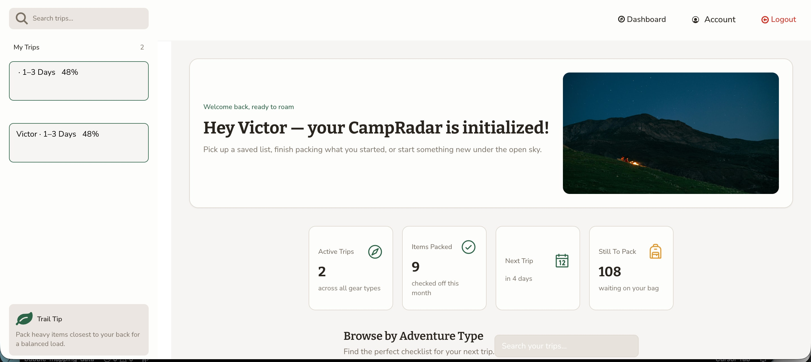

# CampRadar: Dynamic Camping Packing List Web App

> From an Excel gear list to a one-click packing list.

CampRadar is a Bubble web app that generates personalized camping packing lists for tent camping, backpacking, RV camping, or overlanding.

## What I did

1. Converted the client's Excel gear catalog into a Bubble database
2. One click builds a trip checklist
3. Users mark items packed, add or remove gear, and open affiliate gear links
4. A Gear Radar marketplace page for product discovery
5. Mobile and desktop optimization, plus polished packing progress calculations

**Stack:** Bubble.io, database design, responsive design.

[Back to all projects](../README.md)
