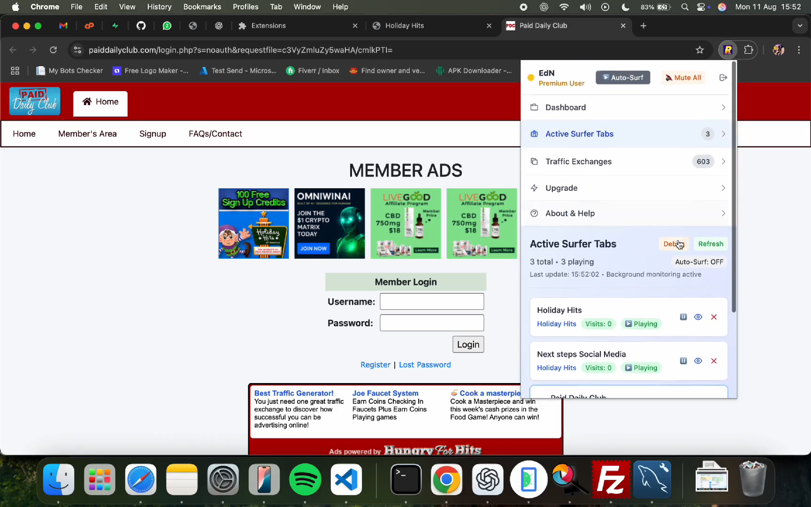

# RapidTabSurf Chrome & Firefox Extension

> Too many tabs? Search them.

I built a Chrome and Firefox extension that makes working with many tabs faster:

1. Instant tab search by keyword
2. Quick switching from the popup
3. A view to sort and manage open tabs
4. Background tab activity tracking

All in a lightweight popup with custom icons, clean styling, and minimal impact on browser performance. The video shows it in action.

**Stack:** JavaScript, HTML, CSS, WebExtensions for Chrome and Firefox.

Demo video: [rapidtabsurf-chrome-firefox-extension.mp4](../videos/rapidtabsurf-chrome-firefox-extension.mp4)

[Back to all projects](../README.md)
